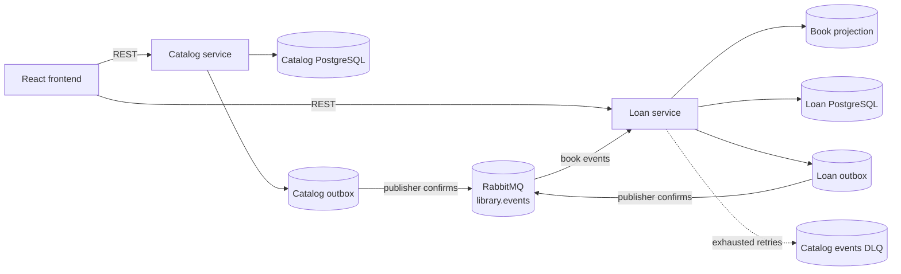
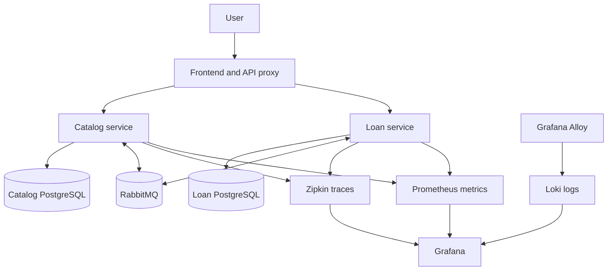
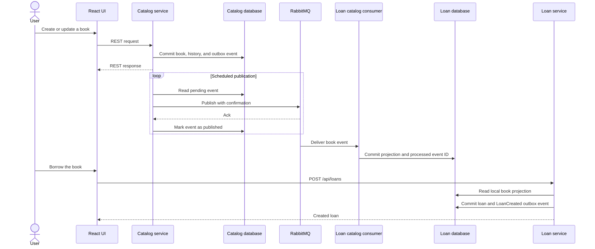

# Production-Ready Event-Driven Library - InfNet TP5

**Author:** Tiberius Dourado<br>
**Stack:** Java 21, Spring Boot 3.5, Spring AMQP, RabbitMQ 4, PostgreSQL 16,
React 18, Docker, Kubernetes, Prometheus, Grafana, Loki, Alloy, and Zipkin

This project manages a library catalog and its loans through two independently
persisted Spring Boot services and one React interface. The fourth delivery
replaces the synchronous service-to-service catalog lookup with versioned domain
events delivered by RabbitMQ.

The fifth delivery packages every application as a non-root container, provides
Docker Compose and Kubernetes deployments, exposes health and Prometheus
metrics, centralizes structured logs in Loki, sends distributed traces to
Zipkin, and automates validation and image publication with GitHub Actions.

The REST APIs and user interface remain synchronous at the system boundary.
Inside the system, each service commits its domain change and outgoing event in
the same database transaction. The loan service consumes catalog events into a
local projection and can therefore validate a loan without calling the catalog
service.

## Architecture



The production topology adds the operational layer around the TP4 event flow:



| Component | Responsibility | Port |
| --- | --- | --- |
| Catalog service | Books, immutable history, and catalog event outbox | `8080` |
| Loan service | Loans, local book projection, consumer, and loan event outbox | `8081` |
| React frontend | Catalog and loan interface | `5173` |
| Catalog PostgreSQL | Catalog-owned tables | `5431` |
| Loan PostgreSQL | Loan-owned tables and projection | `5433` |
| RabbitMQ AMQP | Event transport | `5672` |
| RabbitMQ Management | Broker administration interface | `15672` |
| Grafana | Metrics, logs, and trace data sources | `3000` |
| Prometheus | Service metrics | `9090` |
| Loki | Aggregated structured logs | `3100` |
| Zipkin | Distributed traces | `9411` |

The services do not share tables, entities, or database credentials. OpenFeign
is no longer used. `LoanService` reads `catalog_book_projection`, which is owned
and updated locally by the loan service.

## Event Flow



Delivery is at least once. Duplicate messages are safe because the loan service
stores every consumed UUID in `processed_events`. Projection versions prevent an
older event from overwriting newer book state.

## Message Contracts

All messages use the same envelope:

```json
{
  "eventId": "1adcb07c-e8d4-4ba5-a853-52b9a93fd0e8",
  "eventType": "BookCreated",
  "eventVersion": 1,
  "occurredAt": "2026-09-17T15:00:00Z",
  "source": "catalog-service",
  "payload": {}
}
```

| Event | Routing key | Payload |
| --- | --- | --- |
| `BookCreated` | `library.catalog.book.created.v1` | Complete book state |
| `BookUpdated` | `library.catalog.book.updated.v1` | Complete book state |
| `BookDeleted` | `library.catalog.book.deleted.v1` | Book ID and deletion version |
| `LoanCreated` | `library.loans.loan.created.v1` | Complete loan state |
| `LoanReturned` | `library.loans.loan.returned.v1` | Loan ID, book ID, and return time |

The durable topic exchange is `library.events`. The durable queue
`library.loan-service.catalog-events.v1` binds to
`library.catalog.book.*.v1`.

## Reliability Patterns

- **Transactional outbox:** domain mutations and outgoing messages commit in one
  PostgreSQL transaction.
- **Publisher confirms:** an outbox row is marked published only after a positive
  RabbitMQ confirmation. Catalog events additionally require a successful route
  to the projection queue. Loan-event queues remain owned by future consumers,
  so their producer requires exchange confirmation without mandatory routing.
- **Automatic recovery:** a broker failure leaves the row pending for the next
  scheduled publication cycle.
- **Idempotent consumer:** `processed_events.event_id` prevents duplicate effects.
- **Versioned projection:** stale catalog versions are recorded as processed but
  cannot overwrite current state.
- **Retry and dead letter:** catalog consumption uses three attempts with
  exponential backoff. Exhausted messages are rejected without requeue and sent
  to `library.loan-service.catalog-events.dlq` through
  `library.loan-service.dlx`.

This design improves service autonomy, failure isolation, horizontal consumer
scaling, and extensibility for future notification or analytics consumers. Its
costs are eventual consistency, more infrastructure, duplicated read data,
schema evolution discipline, and more involved operational diagnosis. It is a
good fit when services require independent availability or multiple consumers;
it is unnecessary for small applications that require immediate consistency and
have no meaningful service boundary.

## Requirements

- JDK 21 or newer
- Maven 3.9 or newer
- Node.js 20 or newer
- Docker with Docker Compose
- `kubectl` and Kind for the local Kubernetes option
- `curl` and `jq` for the integrated verification commands

## Start the Application

### Docker Compose

Build and start the complete system from the repository root:

```bash
docker compose up --build -d
docker compose ps
```

Open the application at `http://localhost:5173`. Docker Compose also starts Grafana
at `http://localhost:3000`, Prometheus at `http://localhost:9090`, Zipkin at
`http://localhost:9411`, and RabbitMQ Management at
`http://localhost:15672`. Grafana uses `admin`/`admin`, and RabbitMQ uses
`biblioteca`/`biblioteca`.

Wait until every container reports `healthy` or `running`, then verify the main
endpoints:

```bash
curl --fail http://localhost:5173/health
curl --fail http://localhost:3000/api/health
curl --fail http://localhost:9090/-/ready
curl --fail http://localhost:9411/health
```

Stop the stack without deleting data:

```bash
docker compose down
```

Use `docker compose down -v` only when a completely clean database and broker
state is required.

### Local Kubernetes with Kind

Create the local cluster once:

```bash
kind create cluster --name biblioteca --config k8s/kind-config.yaml
```

Build and load the application images:

```bash
docker build -t biblioteca/catalog:local catalog-service
docker build -t biblioteca/loan:local loan-service
docker build -t biblioteca/frontend:local frontend
kind load docker-image --name biblioteca \
  biblioteca/catalog:local biblioteca/loan:local biblioteca/frontend:local
```

Install Metrics Server for the local HPA demonstration:

```bash
kubectl --context kind-biblioteca apply -f \
  https://github.com/kubernetes-sigs/metrics-server/releases/download/v0.9.0/components.yaml
kubectl --context kind-biblioteca -n kube-system patch deployment metrics-server \
  --type=json \
  -p='[{"op":"add","path":"/spec/template/spec/containers/0/args/-","value":"--kubelet-insecure-tls"}]'
```

Deploy the system and wait for every workload:

```bash
kubectl --context kind-biblioteca apply -k k8s
kubectl --context kind-biblioteca -n biblioteca rollout status statefulset/catalog-postgres --timeout=180s
kubectl --context kind-biblioteca -n biblioteca rollout status statefulset/loan-postgres --timeout=180s
kubectl --context kind-biblioteca -n biblioteca rollout status statefulset/rabbitmq --timeout=180s
kubectl --context kind-biblioteca -n biblioteca rollout status deployment/catalog-service --timeout=240s
kubectl --context kind-biblioteca -n biblioteca rollout status deployment/loan-service --timeout=240s
kubectl --context kind-biblioteca -n biblioteca rollout status deployment/frontend --timeout=120s
kubectl --context kind-biblioteca -n biblioteca rollout status deployment/prometheus --timeout=300s
kubectl --context kind-biblioteca -n biblioteca rollout status deployment/loki --timeout=300s
kubectl --context kind-biblioteca -n biblioteca rollout status deployment/zipkin --timeout=300s
kubectl --context kind-biblioteca -n biblioteca rollout status deployment/grafana --timeout=300s
kubectl --context kind-biblioteca -n biblioteca rollout status daemonset/alloy --timeout=300s
kubectl --context kind-biblioteca -n biblioteca get pods,pvc,hpa
```

The application, Grafana, and Zipkin keep ports `5173`, `3000`, and `9411`.
RabbitMQ Management uses `http://localhost:15673` in Kind to avoid the common
local RabbitMQ port conflict. Run either Docker Compose or Kind at one time
because they share the application and observability ports.

The values in `k8s/config.yaml` are local demonstration credentials. Replace
them through an external secret manager before deploying outside a development
environment.

After source changes, rebuild and reload the images, then restart the application
deployments:

```bash
docker build -t biblioteca/catalog:local catalog-service
docker build -t biblioteca/loan:local loan-service
docker build -t biblioteca/frontend:local frontend
kind load docker-image --name biblioteca \
  biblioteca/catalog:local biblioteca/loan:local biblioteca/frontend:local
kubectl --context kind-biblioteca -n biblioteca rollout restart \
  deployment/catalog-service deployment/loan-service deployment/frontend
```

Delete the local cluster when it is no longer needed:

```bash
kind delete cluster --name biblioteca
```

### Run Components Separately for Development

### 1. Start PostgreSQL and RabbitMQ

```bash
docker compose up -d postgres loans-postgres rabbitmq zipkin
docker compose ps
```

RabbitMQ Management is available at `http://localhost:15672`. The default user
and password are both `biblioteca`.

Named volumes preserve data between restarts. To intentionally delete the three
volumes and start with empty infrastructure, run `docker compose down -v`.

### 2. Start the Catalog Service

```bash
cd catalog-service
mvn spring-boot:run
```

The catalog API is available at `http://localhost:8080/api/books`.

| Variable | Default |
| --- | --- |
| `DB_URL` | `jdbc:postgresql://localhost:5431/biblioteca` |
| `DB_USERNAME` | `biblioteca` |
| `DB_PASSWORD` | `biblioteca` |
| `RABBITMQ_HOST` | `localhost` |
| `RABBITMQ_PORT` | `5672` |
| `RABBITMQ_USERNAME` | `biblioteca` |
| `RABBITMQ_PASSWORD` | `biblioteca` |
| `OUTBOX_ENABLED` | `true` |
| `OUTBOX_FIXED_DELAY` | `1000` |
| `OUTBOX_BATCH_SIZE` | `50` |
| `OUTBOX_CONFIRM_TIMEOUT` | `5s` |

### 3. Start the Loan Service

In a second terminal:

```bash
cd loan-service
mvn spring-boot:run
```

The loan API is available at `http://localhost:8081/api/loans`.

| Variable | Default |
| --- | --- |
| `LOAN_DB_URL` | `jdbc:postgresql://localhost:5433/loans` |
| `LOAN_DB_USERNAME` | `loans` |
| `LOAN_DB_PASSWORD` | `loans` |
| `RABBITMQ_HOST` | `localhost` |
| `RABBITMQ_PORT` | `5672` |
| `RABBITMQ_USERNAME` | `biblioteca` |
| `RABBITMQ_PASSWORD` | `biblioteca` |
| `OUTBOX_ENABLED` | `true` |
| `OUTBOX_FIXED_DELAY` | `1000` |
| `OUTBOX_BATCH_SIZE` | `50` |
| `OUTBOX_CONFIRM_TIMEOUT` | `5s` |

On the first start, the catalog migration creates `BookCreated` outbox records
for existing books. Wait a few seconds for the publisher and consumer to populate
the local projection before creating the first loan.

### 4. Start the Frontend

In a third terminal:

```bash
cd frontend
pnpm install
pnpm dev
```

Open `http://localhost:5173`. `VITE_API_URL` defaults to
`http://localhost:8080/api`, and `VITE_LOAN_API_URL` defaults to
`http://localhost:8081/api`.

## REST APIs

### Catalog

| Method | Path | Description |
| --- | --- | --- |
| `GET` | `/api/books` | List current books |
| `GET` | `/api/books/{id}` | Get one current book |
| `POST` | `/api/books` | Create a book, history snapshot, and event |
| `PUT` | `/api/books/{id}` | Update a book, history snapshot, and event |
| `DELETE` | `/api/books/{id}` | Store final history and emit deletion event |
| `GET` | `/api/books/{id}/history` | List immutable snapshots newest first |

### Loans

| Method | Path | Description |
| --- | --- | --- |
| `GET` | `/api/loans` | List loans newest first |
| `GET` | `/api/loans/{id}` | Get one loan |
| `POST` | `/api/loans` | Borrow a book available in the local projection |
| `PATCH` | `/api/loans/{id}/return` | Return an active loan |

A missing, deleted, or not-yet-projected book returns `404`. This can be a brief
eventual-consistency window immediately after a book is created. An existing
active loan returns `409`.

## Automated Verification

Run each suite from the repository root. Catalog tests:

```bash
mvn -f catalog-service/pom.xml test
```

Loan-service tests:

```bash
mvn -f loan-service/pom.xml test
```

Frontend tests and production build:

```bash
pnpm --dir frontend install --frozen-lockfile
pnpm --dir frontend test
pnpm --dir frontend build
```

Deployment configuration validation:

```bash
docker compose config --quiet
kubectl kustomize k8s >/dev/null
jq empty observability/grafana/dashboards/services.json
```

The suites cover catalog CRUD and history, event factories, transactional
outboxes, publisher confirmations, local projection updates, duplicate and stale
messages, loan rules, retry/DLQ topology, REST validation, frontend behavior,
Actuator exposure, and the Nginx routing configuration.

For an integrated test after Docker Compose or Kind is running, open
`http://localhost:5173`, create a book, wait for its event to reach the loan
projection, borrow it, confirm that a second active loan returns a conflict, and
return the first loan. Then verify monitoring with:

```bash
curl --fail http://localhost:5173/health
curl --fail --user admin:admin http://localhost:3000/api/health
curl --fail --user admin:admin \
  http://localhost:3000/api/datasources/proxy/uid/Prometheus/api/v1/targets
curl --fail http://localhost:9411/api/v2/traces?limit=10
curl --fail --user admin:admin \
  http://localhost:3000/api/datasources/proxy/uid/Loki/loki/api/v1/labels
```

## Observability

- Spring Boot Actuator provides liveness, readiness, and Prometheus endpoints.
- Prometheus scrapes both Java services and Grafana loads the included service
  dashboard automatically in Docker Compose.
- Applications write structured JSON logs. Grafana Alloy collects container or
  Kubernetes pod logs and forwards them to Loki.
- Micrometer tracing exports HTTP, scheduled outbox, and messaging spans to
  Zipkin. Trace IDs are also present in application logs for correlation.

Useful checks when Docker Compose is running:

```bash
curl http://localhost:5173/health
curl http://localhost:9090/api/v1/targets
curl http://localhost:9411/api/v2/traces?limit=10
```

## CI/CD

`.github/workflows/ci.yml` runs both Maven suites, frontend tests and build,
deployment configuration validation, and all three container builds on pushes
and pull requests. After CI succeeds on `main`, `.github/workflows/cd.yml`
deploys the exact revision to an ephemeral Kind cluster, runs the integrated
smoke test, and only then publishes versioned and `latest` images to GitHub
Container Registry.

## Operations

Inspect and scale the Kubernetes deployment:

```bash
kubectl --context kind-biblioteca -n biblioteca get pods,hpa
kubectl --context kind-biblioteca -n biblioteca top pods
kubectl --context kind-biblioteca -n biblioteca scale deployment/catalog-service --replicas=2
```

The HPA may adjust manual replica counts back toward its configured target.
Roll back a failed deployment revision with:

```bash
kubectl --context kind-biblioteca -n biblioteca rollout history deployment/catalog-service
kubectl --context kind-biblioteca -n biblioteca rollout undo deployment/catalog-service
```

Back up both Docker Compose databases before maintenance:

```bash
docker compose exec -T postgres pg_dump -U biblioteca biblioteca > catalog-backup.sql
docker compose exec -T loans-postgres pg_dump -U loans loans > loans-backup.sql
```

Restore into empty databases with `psql` after confirming that the target data
may be replaced. Persistent volumes protect restarts but are not substitutes for
external backups.

For troubleshooting, inspect workload events and structured logs:

```bash
docker compose ps
docker compose logs --tail=200 catalog-service loan-service alloy loki
kubectl --context kind-biblioteca -n biblioteca get events --sort-by=.lastTimestamp
kubectl --context kind-biblioteca -n biblioteca logs deployment/catalog-service --tail=200
kubectl --context kind-biblioteca -n biblioteca describe pod -l app=catalog-service
```

## Demonstration

### Normal flow through the UI

1. Start all infrastructure, both services, and the frontend.
2. Open the frontend and create a book.
3. Wait up to two seconds, select **Borrow**, enter a borrower and a future date,
   and confirm.
4. Verify the loan appears with `ACTIVE` status.
5. Attempt another loan for the same book and observe the conflict.
6. Return the loan and verify `RETURNED` status.
7. Open RabbitMQ Management and inspect exchange `library.events` and queue
   `library.loan-service.catalog-events.v1`.

### Catalog-service outage

1. Complete the normal flow so the local projection exists.
2. Stop only the catalog Spring Boot process.
3. Call `POST http://localhost:5173/api/loans` for a projected book that has no
   active loan.
4. The loan succeeds because validation is local. Catalog mutation and catalog UI
   operations remain unavailable until that service restarts.

### Broker outage and recovery

1. Stop RabbitMQ with `docker compose stop rabbitmq`.
2. Create or update a book through the catalog REST API. The REST transaction
   still succeeds.
3. Confirm its catalog outbox row has `published_at = NULL`:

```bash
docker compose exec postgres psql -U biblioteca -d biblioteca \
  -c "SELECT event_type, attempts, published_at FROM outbox_events ORDER BY created_at DESC LIMIT 5;"
```

4. Restart the broker with `docker compose start rabbitmq`.
5. The next scheduled cycle publishes the pending event and the loan projection
   catches up automatically.

### Duplicate delivery

1. In RabbitMQ Management, open exchange `library.events`.
2. Publish the same valid `BookCreated` JSON twice with routing key
   `library.catalog.book.created.v1` and the same `eventId`.
3. Confirm only one processed marker exists:

```bash
docker compose exec loans-postgres psql -U loans -d loans \
  -c "SELECT event_id, COUNT(*) FROM processed_events GROUP BY event_id;"
```

### Dead-letter handling

1. Publish a catalog event with `eventVersion` set to `99` to exchange
   `library.events` and a matching catalog routing key.
2. The consumer rejects it after three attempts.
3. Inspect queue `library.loan-service.catalog-events.dlq` in RabbitMQ Management.
   The rejected message remains available for diagnosis and controlled replay.

## Persistence

Flyway owns the production schemas, while Hibernate uses `ddl-auto: validate`.

- Catalog: `books`, `book_history`, and `outbox_events`.
- Loan service: `loans`, `catalog_book_projection`, `processed_events`, and
  `outbox_events`.

Outbox tables retain published rows as an event audit trail. Operational cleanup
can archive old published records without touching pending ones.

## Project Structure

```text
.
├── catalog-service
│   └── src
├── loan-service
│   └── src
├── frontend
│   └── src
├── k8s
├── observability
├── .github/workflows
├── docker-compose.yml
└── README.md
```
